# iPodClassic

A native iOS app that puts a full iPod Classic in your pocket: a real click wheel with haptics and tick sounds, a scanlined LCD, and the classic menus — wired to **Apple Music** (you need a subscription), plus a PDF/EPUB book reader, camera, voice recorder, weekday alarms, and Live Activities.

I wanted this not just because I wanted the vibes of an iPod but mainly because it takes away so much of the distraction of my phone. I can use it with Guided access and it has basically all the normal things I need. If I need anything else, I can just quit Guided access or swipe out.

<p align="center">
  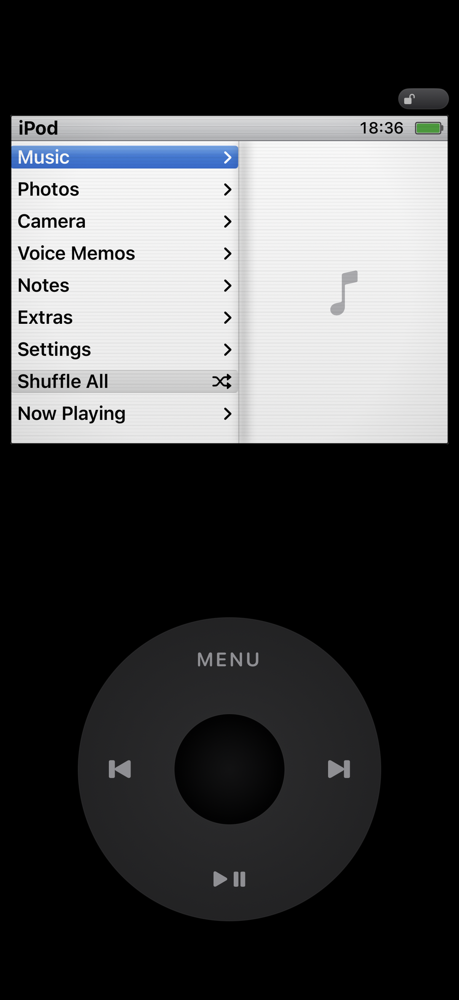
  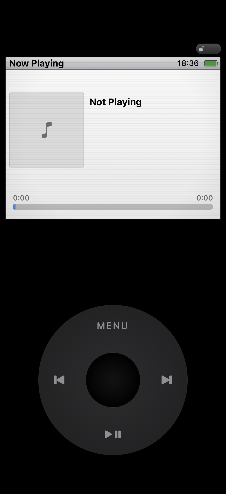
  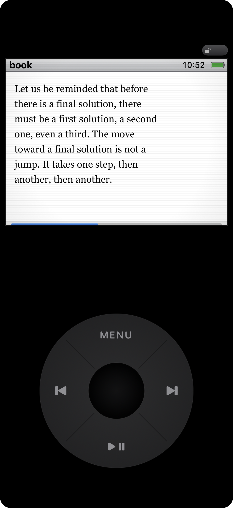
</p>

> Full documentation site: **<https://subhadityamukherjee.github.io/iPodClassicEmu/>**

## Features

**The device feel**

- Full-device UI: black (or silver) body, working Hold switch, LCD with subtle CRT scanlines and backlight illusion
- Real click wheel: angle-based scroll ticks (15°/detent), press-and-turn, hold timers with repeat, CoreHaptics tick feedback and click sounds, subtle sector seams and a dimmed wheel like real hardware
- Wheel-only navigation with the classic quirks: MENU pops one level, MENU-hold goes home, PLAY-hold sleeps

**Music (Apple Music via MusicKit)**

- Artists, albums, songs, genres, playlists, recently added — synced from your Apple Music library, and refreshed whenever you open Music or foreground the app
- Cover Flow with 3D flipping covers and numbered track overlay
- Now Playing with marquee text, volume on the wheel, scrubbing, shuffle and repeat
- Playback keeps working in the background; Now Playing follows auto-advance and manual skips even while backgrounded
- **Queue**: hold the center button on any song row to "play next"; Now Playing → hold center → Up Next shows the whole queue and can jump to any entry
- **Search**: ranked results (title > artist > album); hold center on a result to jump to the artist or album
- **AirPlay** from Now Playing → hold center

<p align="center">
  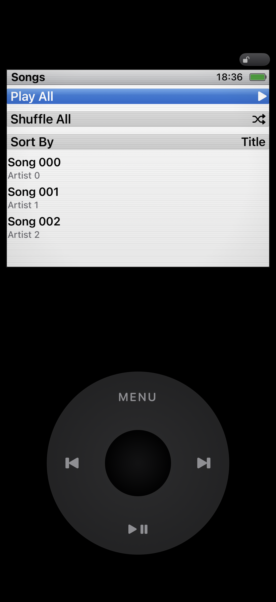
  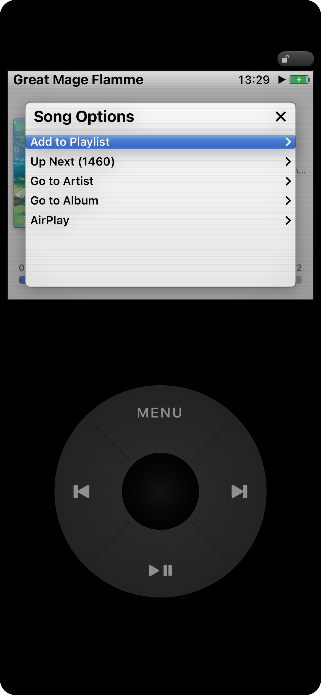
  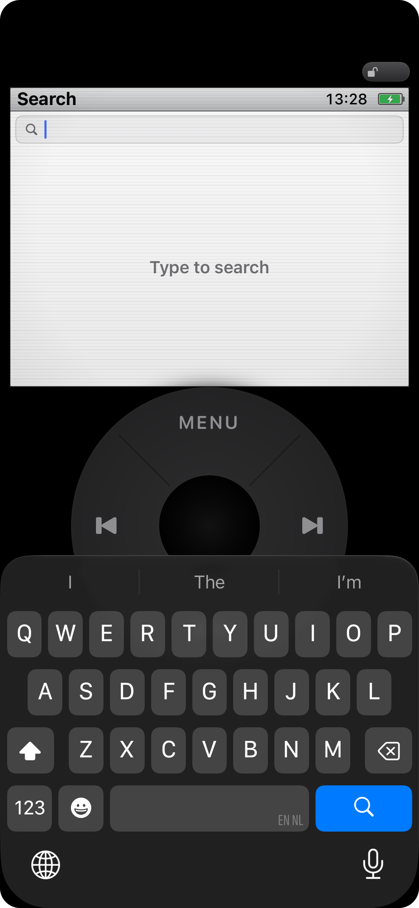
</p>

**Clocks**

- Classic alarm clock with iPhone-style weekday repeats (S M T W T F S; none selected = daily), in-app ringer with Snooze/Stop, notification-backed so it fires even when the app is closed
- Timer and Stopwatch — each with a **Live Activity**: live countdown/elapsed time on the lock screen and Dynamic Island, timer flips to "Done" when it fires in the background

<p align="center">
  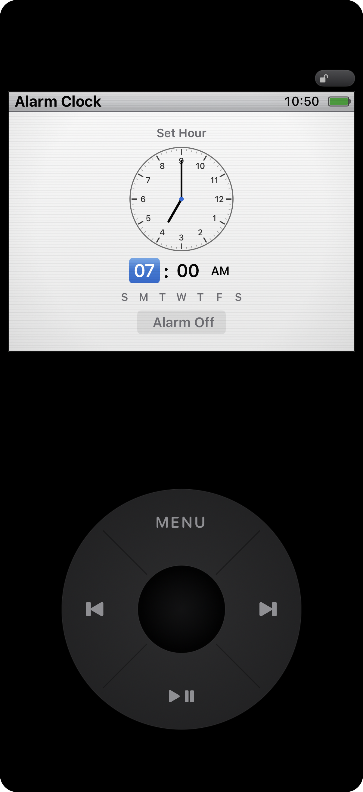
  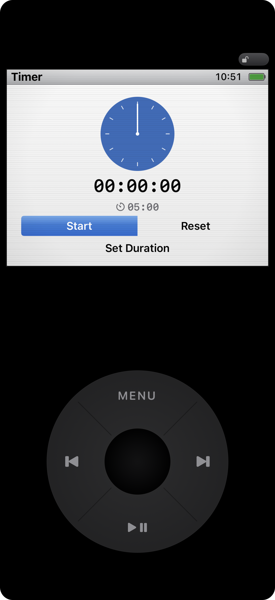
</p>

**Reader**

- Import PDFs and EPUBs from the Files app; everything stays on-device
- True page-based EPUB reading: pages filled with complete lines only (no half-cut text ever), one wheel tick = one page turn, adjustable font size (11–25 px), serif/sans, line spacing, margins, and screen dimming
- PDFs render via PDFKit with continuous or one-page mode
- Chapter navigation with titles from the book's own table of contents; per-book position memory that survives force-quits and app updates
- Page-accurate whole-book progress bar; highlights (EPUB and PDF) persist and mirror into a Notes file; hold center for per-book settings

<p align="center">
  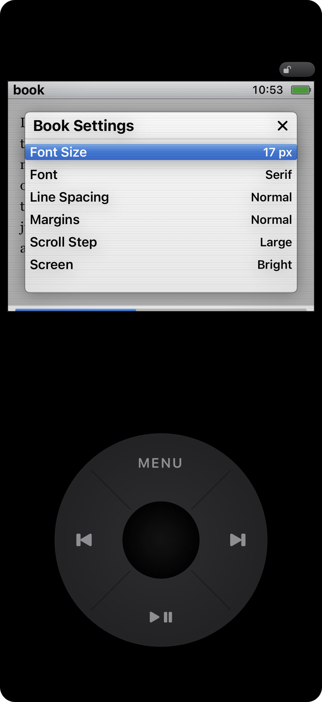
  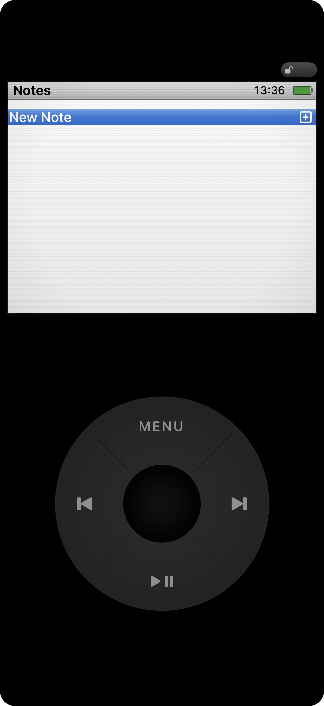
</p>

**Everything else**

- Camera with wheel zoom, aspect-ratio switching (prev/next), lens flip (hold), wheel-driven capture — just like the real thing
- You can map the camera in this app to your action button as well!
- Photos grid + full-screen detail
- Voice recorder: background-safe long recordings, pause/resume, playback, share sheet
- Notes editor with autosave; files visible in the Files app
- Calendar, flashlight, and an About screen
- Settings for haptics, wheel behavior, display (CRT/scanlines/dim), playback, and themes

<p align="center">
  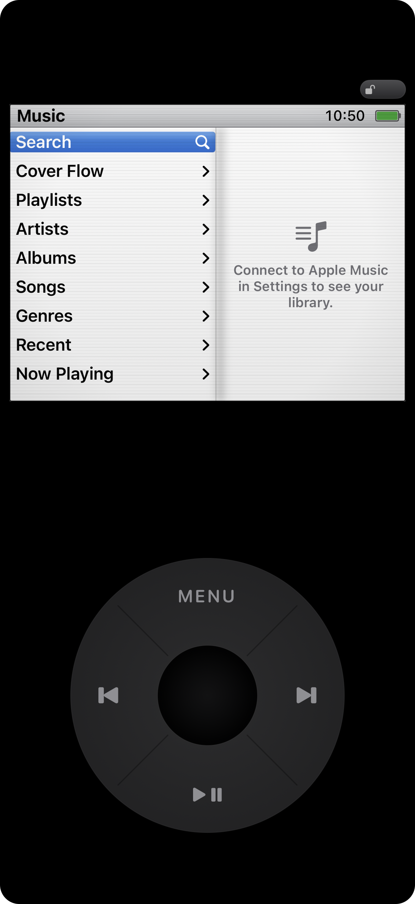
  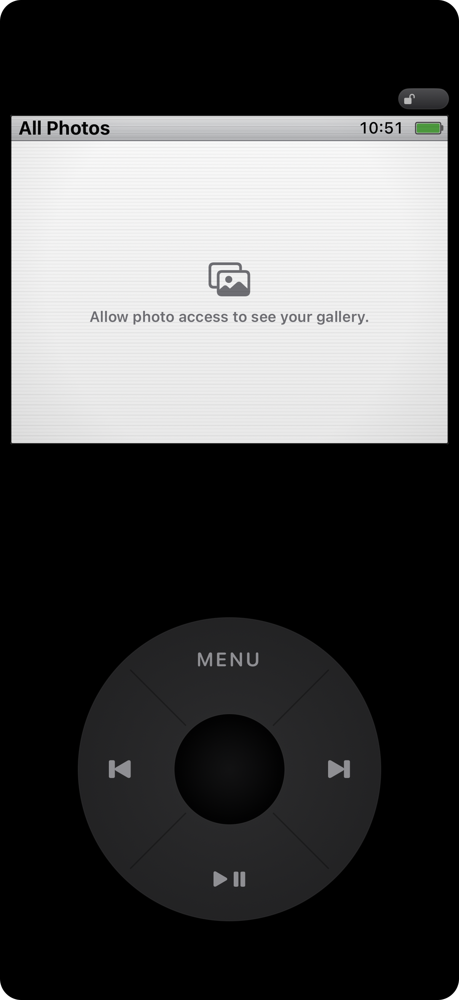
  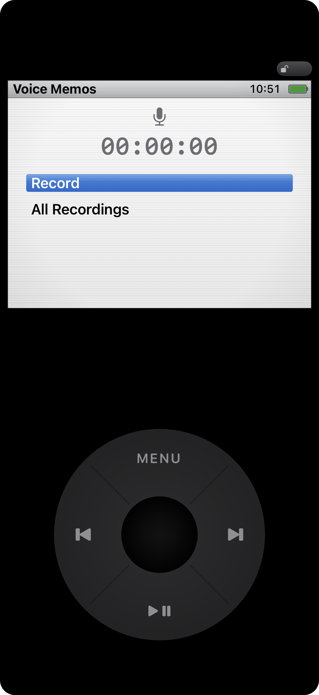
  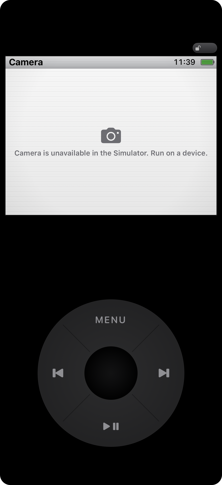
  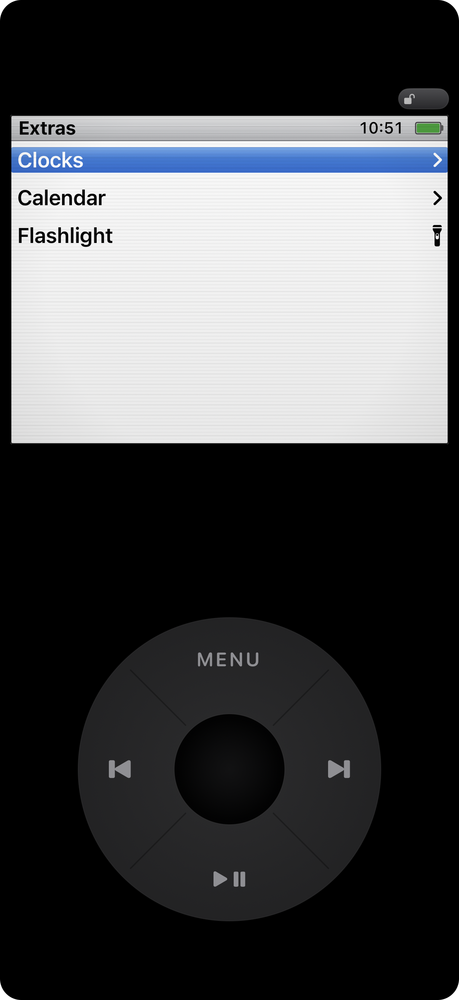
  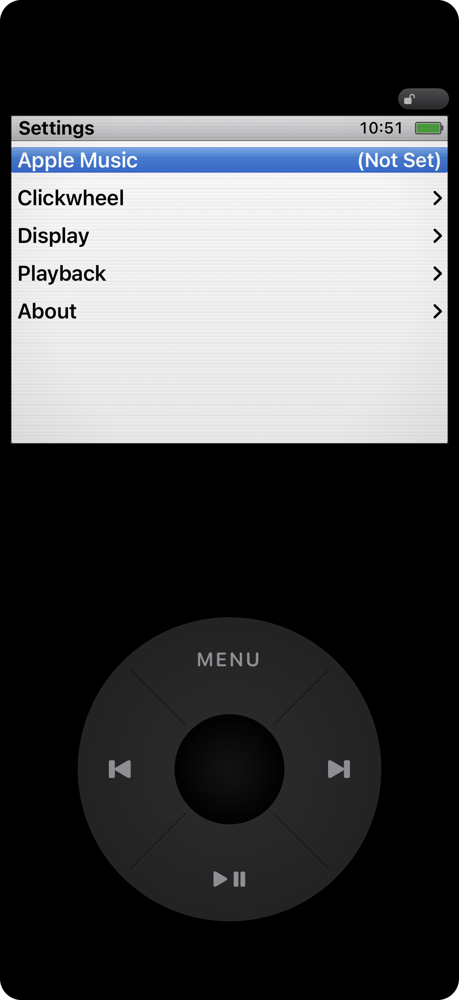
</p>

## Requirements

- Xcode 26+ with the iOS 18 SDK (project uses `xcodegen`)
- An Apple ID for signing (the free Personal Team works for on-device runs; MusicKit needs automatic signing enabled)
- A **physical iPhone** for music playback, camera, haptics, and Live Activities (ApplicationMusicPlayer is a no-op in the simulator)
- An Apple Music subscription or a synced music library for the Music features

## Building

```sh
brew install xcodegen           # if you don't have it
xcodegen generate               # regenerate iPodClassic.xcodeproj from project.yml
open iPodClassic.xcodeproj      # set your signing team, then Run
```

Or from the command line:

```sh
xcodebuild -project iPodClassic.xcodeproj -scheme iPodClassic \
  -destination 'platform=iOS Simulator,name=iPhone 17' build
```

Install on your device:

```sh
xcodebuild -project iPodClassic.xcodeproj -scheme iPodClassic \
  -destination 'id=<YOUR-UDID>' -allowProvisioningUpdates build
xcrun devicectl device install app --device <YOUR-UDID> \
  ~/Library/Developer/Xcode/DerivedData/iPodClassic-*/Build/Products/Debug-iphoneos/iPodClassic.app
```

## Tests

```sh
xcodebuild -project iPodClassic.xcodeproj -scheme iPodClassic \
  -destination 'platform=iOS Simulator,name=iPhone 17' test
```

- **Unit tests** (`Tests/iPodClassicTests/`) cover time formatting, wheel geometry, alarm math and weekday repeats, the player model, the reader store, ZIP/EPUB extraction and parsing, and the highlight store.
- **UI tests** (`Tests/UITests/`) drive the click wheel with real touch events and verify navigation, the alarm ringer, search, and the reader end to end.

The app exposes launch-environment hooks for testing and screenshots: `RESET_DEFAULTS=1`, `START_ROUTE=<route>` (plus `readerLast` to reopen the last book), `FAKE_LIBRARY=1` (seed songs and a fake Now Playing track — MusicKit items can't be constructed in tests), `ALARM_FIRE_SECONDS=N`, `READER_IMPORT=<file>` + `READER_CHAPTER=<n>` + `READER_TICKS=<n>` for EPUB harness runs, `NOW_PLAYING_PANEL=1` / `BOOK_SETTINGS=1` to open the hold-panels. `scripts/round_corners.swift` rounds screenshot corners for the README.

## Project structure

```
project.yml                 xcodegen spec (source of truth for the .xcodeproj)
Sources/
  App/                      @main, AppModel (nav stack + input router), Live Activities
  Device/                   device body, LCD, CRT overlay, screen router
  Wheel/                    click wheel gestures, haptics, tick sounds
  UI/                       theme, menus, modal panels, artwork
  Features/                 one self-contained folder per feature
    Music/  Photos/  Camera/  Recorder/  Notes/  Clocks/  Extras/  Reader/  Settings/
  Support/                  QA seed data for tests and screenshots
Shared/                     activity attributes shared with the widget target
Widgets/                    Live Activity widget extension
Tests/                      unit + UI tests
scripts/                    icon generator, screenshot post-processing
docs/screenshots/           app screenshots
```

Input flows one way: `ClickWheelView` → `AppModel.handle(ControlEvent)` → a Combine `controlBus` → only the top screen reacts. Every screen is a `Route` on the navigation stack; deep screens stay alive so state survives pops, exactly like drilling into menus on the real device. More detail for contributors lives in [`AGENTS.md`](AGENTS.md).

## Notes & legal

- This is a personal hobby project and is **not affiliated with or endorsed by Apple**. iPod classic is a trademark of Apple Inc.
- Music features require MusicKit entitlements and an Apple Music-associated Apple ID; your library data stays within Apple's standard MusicKit access on your own device.
- Books, notes, and recordings you import live in the app's Documents folder and sync to the Files app; nothing is uploaded anywhere.
