# iPodClassic

*A native iOS app that puts a full iPod Classic in your pocket.*

A real click wheel with haptics and tick sounds, a scanlined LCD, and
the classic menus — wired to **Apple Music**. Plus a PDF/EPUB reader
with on-device read-aloud, voice memos with private on-device
transcription, a camera, and timers with Live Activities.

<div markdown style="display:flex;gap:14px;flex-wrap:wrap;justify-content:center;margin:18px 0;">
  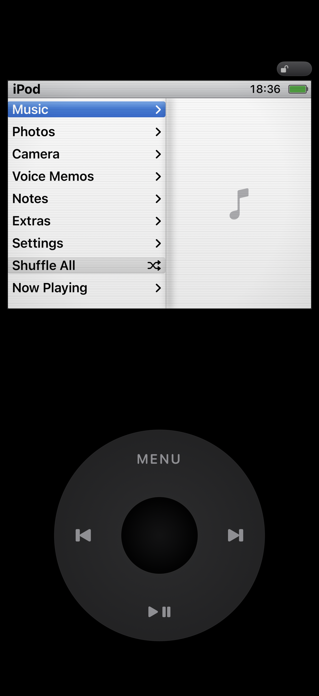
  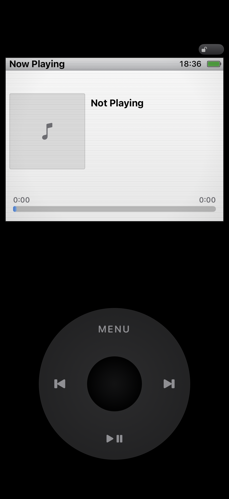
  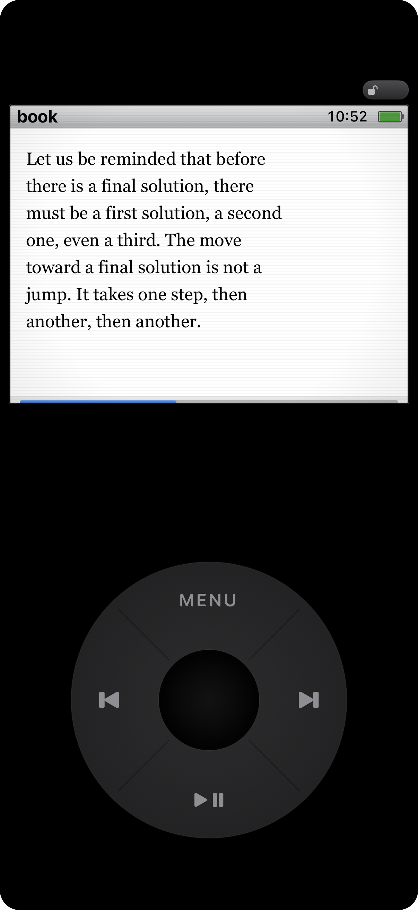
</div>

[:material-github: Source on GitHub](https://github.com/SubhadityaMukherjee/iPodClassicEmu){ .md-button .md-button--primary }
[Build & install](#build-install){ .md-button }

---

## The device

- **Real click wheel** — angle-based ticks (15°/detent), press-and-turn,
  hold timers with repeat, CoreHaptics feedback and click sounds
- **LCD with CRT scanlines**, idle dimming, a working Hold switch
- **Classic quirks** — MENU pops one level, MENU-hold goes home,
  PLAY-hold sleeps
- Wheel-only navigation; deep screens stay alive like real menu drills

## Music — Apple Music via MusicKit

**Library**

- Artists, albums, songs, genres, playlists, recently added
- Auto-refresh on foreground and when opening Music
- Cover Flow with 3D flipping covers

**Playback**

- Now Playing: marquee text, wheel volume, scrub, shuffle, repeat
- Background playback; tracks auto-advance in sync, even backgrounded
- **Queue**: hold center on a song → play next; Up Next list with
  jump-to-entry
- **AirPlay** from the hold menu

**Search**

- Ranked results: title > artist > album
- Hold center on a result → jump to the artist or album

## Clocks

- **Timer & Stopwatch** with **Live Activities** on the lock screen and
  Dynamic Island
- Timer flips to "Done" if it fires while backgrounded

## Reader — PDF & EPUB

**Reading**

- Import from the Files app; everything stays on-device
- True page-based EPUB reading — pages hold complete lines only, one
  tick = one page
- Font 11–25 px, serif/sans, line spacing, margins, screen dimming
- PDFs via PDFKit (continuous, one-page, or **reflowed** — text PDFs
  re-typeset at your font size)
- **Read Later**: save any article URL; boilerplate is stripped and it
  joins the library as a clean one-chapter book

**Read Aloud — on-device TTS**

- Neural text-to-speech runs entirely on-device (Supertonic3, ~400 MB
  download, no cloud, no account)
- Wheel seeks, chapters skip, voice/speed/volume in the hold panel;
  multilingual (en/nl/de/fr/es/it)
- Synthesizes page by page and follows along as you read

**Memory & marks**

- Chapter titles from the book's own table of contents
- Position survives force-quits and app updates (autosave + background
  flush)
- Page-accurate whole-book progress bar
- Highlights persist and mirror into a Notes file; PDF highlights are
  written into the PDF itself

## Everything else

- **Camera** — wheel zoom, prev/next = aspect ratio, hold = lens flip,
  center = capture
- **Voice Memos** — background-safe long recordings, pause/resume,
  playback, share sheet; **on-device transcription** (Parakeet, 25
  languages) with a Live-Activity progress card; retry & share the
  clean text — audio never leaves the phone
- **Photos & Notes** — photo grid + full-screen detail; Notes editor
  with autosave, visible in Files, deleted notes restorable from Trash
- **Extras** — calendar, flashlight, binaural-beat generator,
  full-library music search; settings for haptics, wheel, display,
  playback, read-aloud voices

## Screenshots

<div markdown style="display:grid;grid-template-columns:repeat(auto-fit,minmax(170px,1fr));gap:12px;margin:14px 0;">
  <figure style="margin:0;text-align:center;">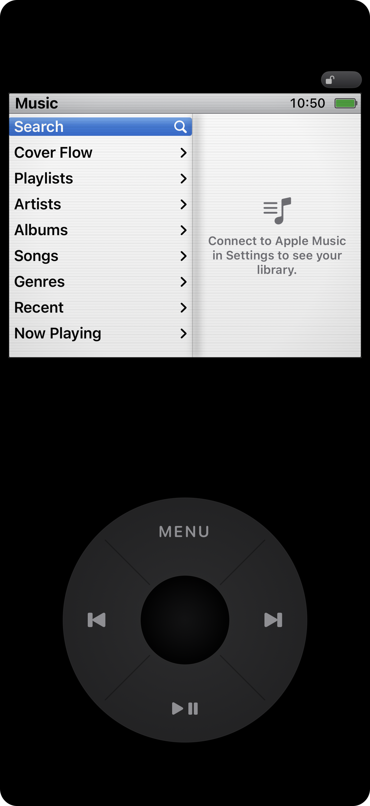<figcaption style="font-size:12.5px;opacity:.75;">Music menu</figcaption></figure>
  <figure style="margin:0;text-align:center;">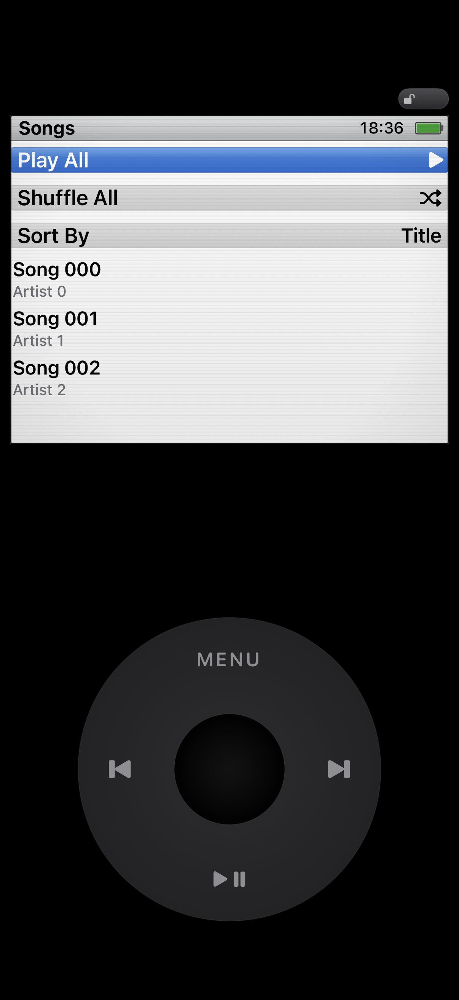<figcaption style="font-size:12.5px;opacity:.75;">Songs</figcaption></figure>
  <figure style="margin:0;text-align:center;">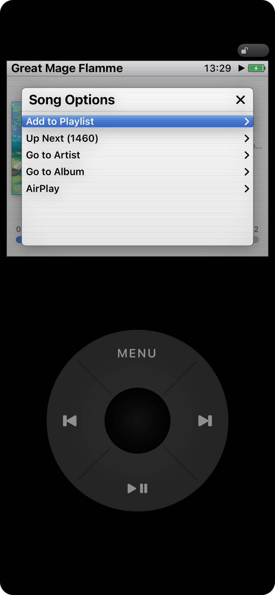<figcaption style="font-size:12.5px;opacity:.75;">Song options / Up Next</figcaption></figure>
  <figure style="margin:0;text-align:center;">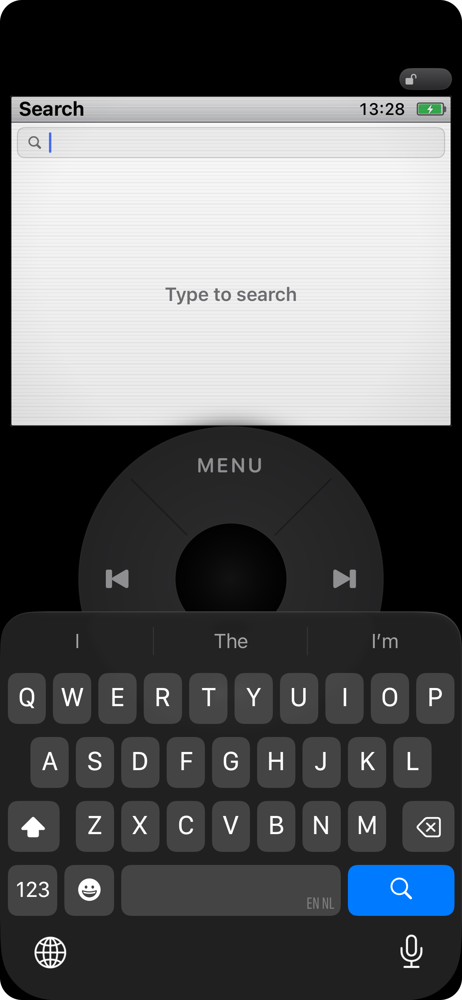<figcaption style="font-size:12.5px;opacity:.75;">Search</figcaption></figure>
  <figure style="margin:0;text-align:center;">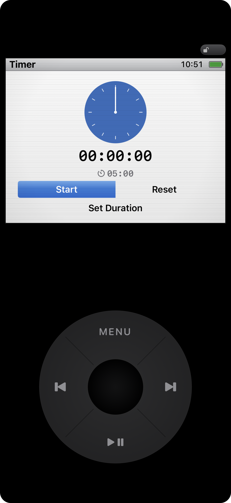<figcaption style="font-size:12.5px;opacity:.75;">Timer</figcaption></figure>
  <figure style="margin:0;text-align:center;">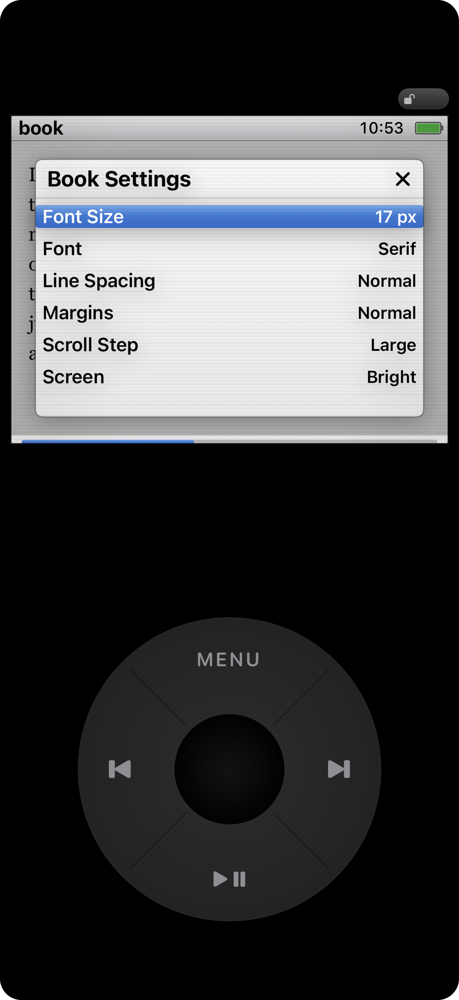<figcaption style="font-size:12.5px;opacity:.75;">Book settings</figcaption></figure>
  <figure style="margin:0;text-align:center;">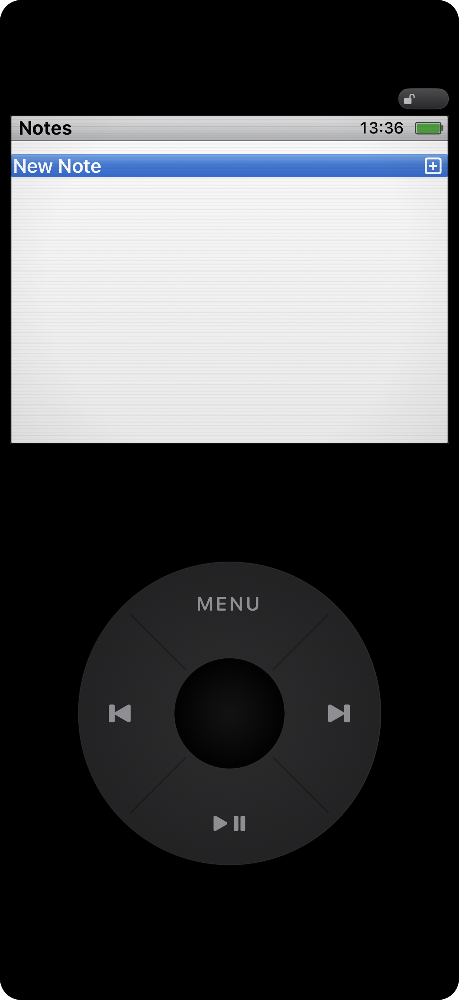<figcaption style="font-size:12.5px;opacity:.75;">Notes</figcaption></figure>
  <figure style="margin:0;text-align:center;">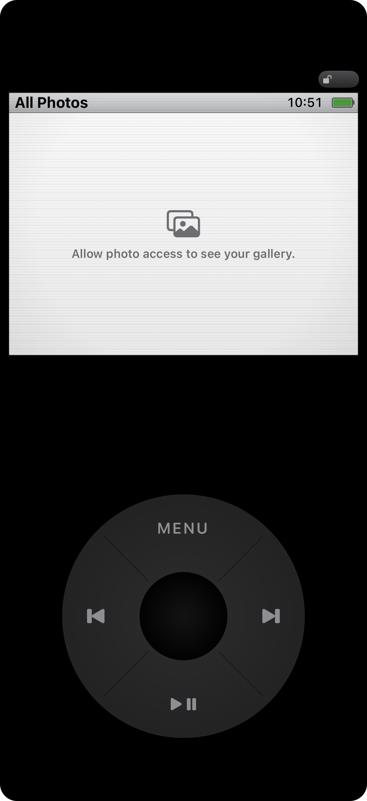<figcaption style="font-size:12.5px;opacity:.75;">Photos</figcaption></figure>
  <figure style="margin:0;text-align:center;">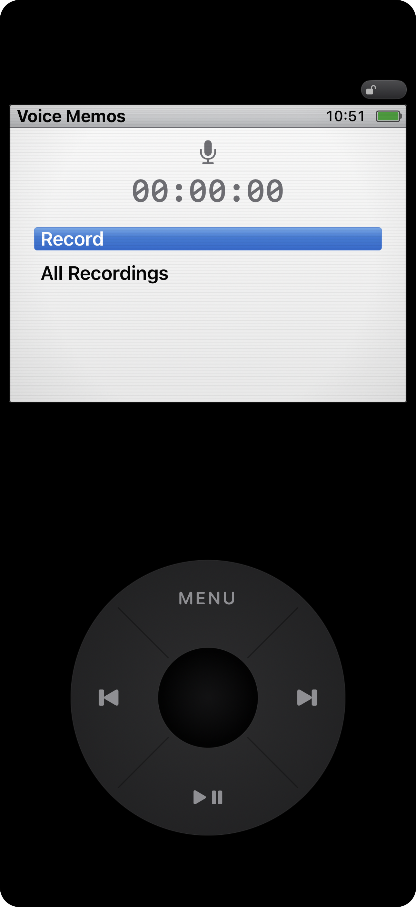<figcaption style="font-size:12.5px;opacity:.75;">Voice memos</figcaption></figure>
  <figure style="margin:0;text-align:center;">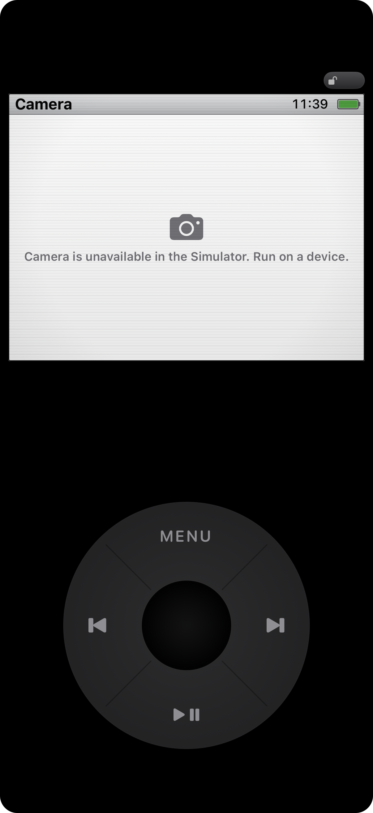<figcaption style="font-size:12.5px;opacity:.75;">Camera (needs a device)</figcaption></figure>
  <figure style="margin:0;text-align:center;">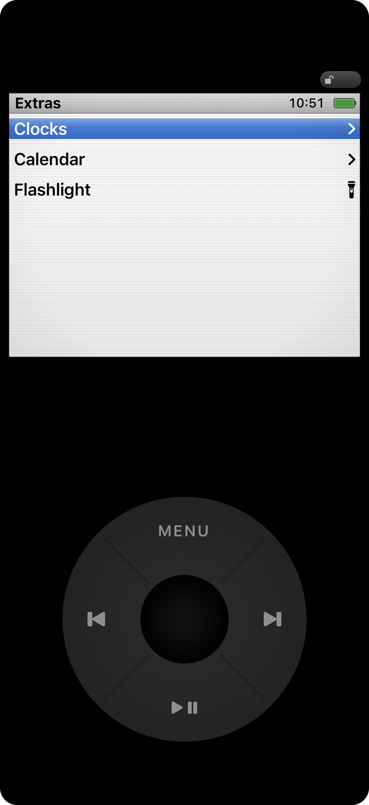<figcaption style="font-size:12.5px;opacity:.75;">Extras</figcaption></figure>
  <figure style="margin:0;text-align:center;">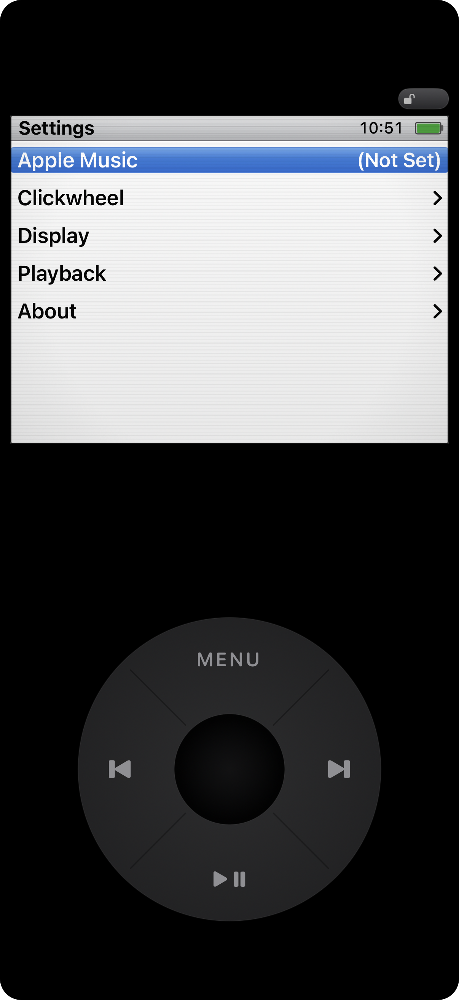<figcaption style="font-size:12.5px;opacity:.75;">Settings</figcaption></figure>
</div>

## Build & install

Requirements: **Xcode 27+** (iOS 18+ SDK),
[`xcodegen`](https://github.com/yonyz/xcodegen), an Apple ID for signing
(the free Personal Team works), and a **physical iPhone** for music,
camera, haptics and Live Activities.

```sh
brew install xcodegen
xcodegen generate                    # regenerate the .xcodeproj from project.yml
open iPodClassic.xcodeproj           # set your signing team, then Run

# or headless:
xcodebuild -project iPodClassic.xcodeproj -scheme iPodClassic \
  -destination 'platform=iOS Simulator,name=iPhone 17' build

# on your device:
xcodebuild -project iPodClassic.xcodeproj -scheme iPodClassic \
  -destination id=<YOUR-UDID> -allowProvisioningUpdates build
xcrun devicectl device install app --device <YOUR-UDID> \
  ~/Library/Developer/Xcode/DerivedData/iPodClassic-*/Build/Products/Debug-iphoneos/iPodClassic.app
```

## Tests & QA hooks

```sh
xcodebuild -project iPodClassic.xcodeproj -scheme iPodClassic \
  -destination 'platform=iOS Simulator,name=iPhone 17' test
```

Unit tests cover time formatting, wheel geometry, the player model, the
reader store, ZIP/EPUB extraction and parsing, and the highlight store.
UI tests drive the click wheel with real touch events end to end.

Launch-environment hooks (also used for the screenshots above):

| Hook | Effect |
|---|---|
| `RESET_DEFAULTS=1` | Clear all persisted settings/stores |
| `START_ROUTE=<route>` | Open a screen directly (`music`, `songs`, `nowplaying`, `timer`, `camera`, …); `readerLast` reopens the last book |
| `FAKE_LIBRARY=1` | Seed 300 fake songs + a fake Now Playing track (MusicKit items can't be constructed in tests) |
| `READER_IMPORT=<file>` `READER_CHAPTER=<n>` `READER_TICKS=<n>` | EPUB harness: import a book, open a chapter, turn N pages |
| `NOW_PLAYING_PANEL=1` / `BOOK_SETTINGS=1` | Open the Now Playing / Book Settings hold-panels |
| `QA_TRANSCRIBE=<file>` / `QA_TTS=<text>` | End-to-end transcription / read-aloud runs; stage status to `Documents/qa_status.txt` plus RTF & memory-headroom logs |

## Architecture in one paragraph

`project.yml` is the source of truth (the `.xcodeproj` is generated).
Input flows one way: `ClickWheelView` → `AppModel.handle(ControlEvent)`
→ a Combine `controlBus` → only the top screen reacts. Every screen is
a `Route` on a navigation stack; deep screens stay alive so state
survives pops, exactly like drilling into menus on the real device.
Features live in self-contained folders under `Sources/Features/`
(Music, Photos, Camera, Recorder, Notes, Clocks, Extras, Reader,
Settings). A widget-extension target (`iPodClassicWidgets`) renders the
Live Activities.

## Documentation

Every declaration in the app carries Quick-Help docstrings, and each
framework/language concept the code relies on is explained **once** in
the [concept docs](concepts/) — written for someone who knows
programming but is new to Swift and iOS:

- **Swift language** — optionals, closures, structs vs classes, errors,
  async/await, actors, property wrappers, protocols & generics
- **System services** — Foundation, UserDefaults, NSCache,
  notifications, Live Activities, the app sandbox
- **Media & hardware** — MusicKit queue semantics, PhotoKit caching,
  the camera session queue, CoreHaptics, AVAudioSession policy,
  MPVolumeView
- **Documents** — EPUB/ZIP internals, WKWebView pagination, PDFKit
  quirks, on-device ML (ASR/TTS)

Project guides:

- [ARCHITECTURE.md](ARCHITECTURE/) — how the pieces fit
- [DESIGN-DECISIONS.md](DESIGN-DECISIONS/) — why it is built this way
- [TESTING.md](TESTING/) — unit + E2E strategy
- [ADDING-FEATURES.md](ADDING-FEATURES/) — adding a feature, step by step
- [AGENTS.md](AGENTS/) — the contributor/agent guide

## Origin

The app began as a one-page brief
([agent.md](https://github.com/SubhadityaMukherjee/iPodClassicEmu/blob/main/agent.md))
describing the device, the features and a folder of reference
screenshots — then grew feature by feature (branch → build → test →
merge) with AI coding agents doing the implementation. The original
reference images are not included in this repository.

## FAQ

**Does music work without Apple Music?**
The Music features mirror your Apple Music library through MusicKit —
a synced library (subscription or local-synced songs) is required.

**Why is the camera black in the simulator?**
Simulators have no camera hardware. The app shows a friendly notice;
run on a device for the real viewfinder.

**Where do my books and notes live?**
In the app's Documents folder, visible in the Files app. Nothing is
uploaded anywhere.

**Does transcription / read-aloud send my audio to a server?**
No. Speech-to-text and text-to-speech run entirely on-device with
downloaded neural models. Nothing is uploaded.

**Do the Live Activities need anything special?**
They work on device out of the box (lock screen + Dynamic Island).
Simulators can render them, but the Island needs hardware.

---

*A personal hobby project — **not affiliated with or endorsed by
Apple**. iPod classic is a trademark of Apple Inc. Music features use
Apple's standard MusicKit access; your library data stays on your
device.*
